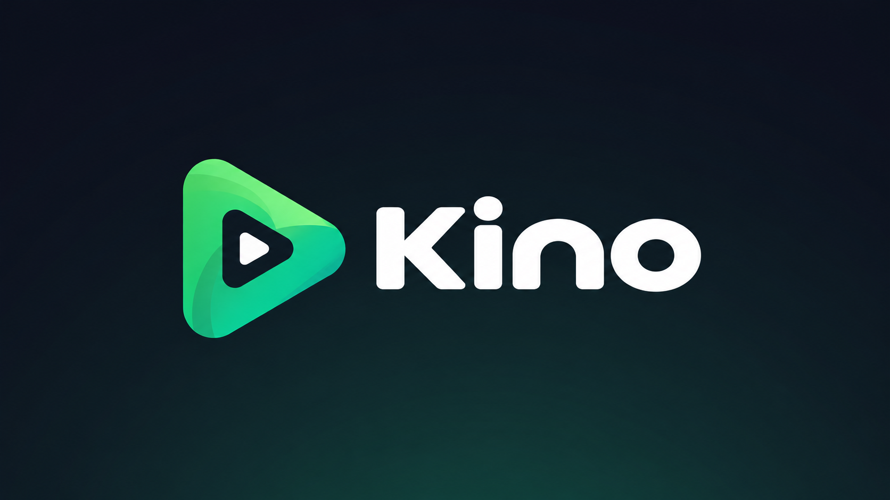
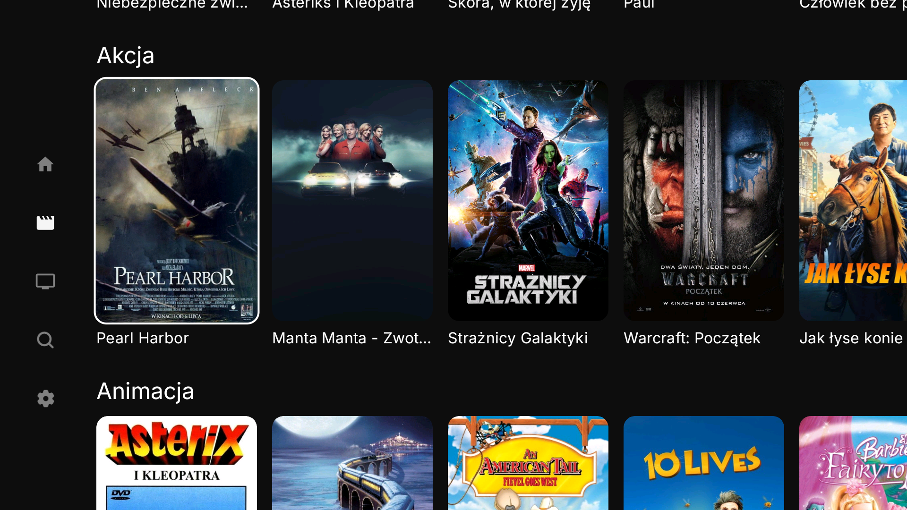
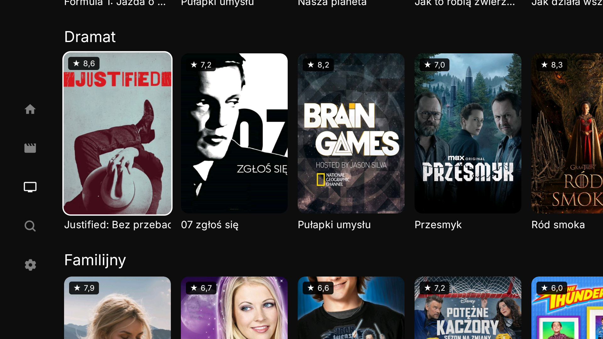
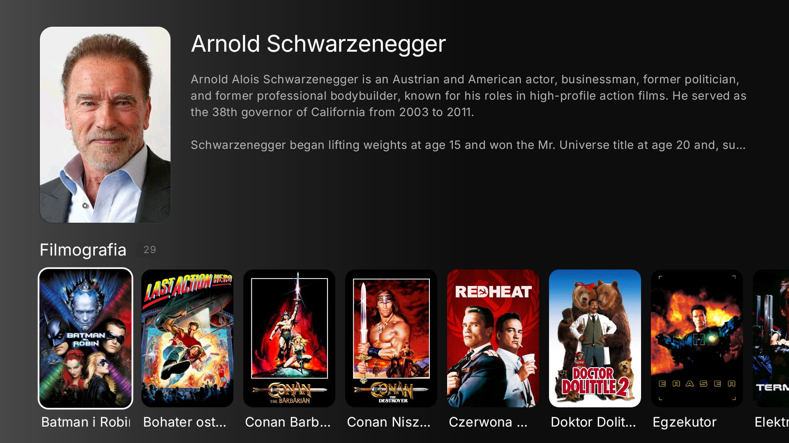

  
  <h1>Kino</h1>
  
<strong>Filmy i seriale z Emby na Android TV</strong>

  

    
    
    
  

  
<a href="#co-oferuje-kino">Funkcje</a> · <a href="#instalacja">Instalacja</a> · <a href="#polskie-plakaty">Polskie plakaty</a> · <a href="https://github.com/shymon999/Kino/issues">Zgłoś błąd</a>

Kino to fork [NuvioTV](https://github.com/NuvioMedia/NuvioTV) dostosowany do bibliotek Emby. Do korzystania potrzebujesz własnego konta i adresu serwera Emby.

## Co oferuje Kino

| Funkcja | Działanie |
| --- | --- |
| Listy według gatunków | Osobne zakładki Filmy i Seriale, polskie nazwy i scalanie podobnych gatunków. |
| Własny układ | Ukrywanie gatunków i zmiana kolejności list. Ukryte tytuły pozostają w wyszukiwaniu. |
| Wyszukiwanie z literówkami | Przybliżone dopasowanie tytułów i nazwisk, także z wyszukiwania głosowego. |
| Filmografie | Wybierz aktora, aby zobaczyć jego filmy i seriale dostępne na serwerze. |
| Osobna historia na każdym TV | Dwa telewizory na jednym koncie Emby mają własne „Kontynuuj oglądanie”. |
| Polskie plakaty | Opcjonalnie z TMDB, po podaniu własnego klucza API. |
| Oceny przy plakatach | Widoczne przed otwarciem filmu lub serialu. |
| Losowa kolejność | Inny układ tytułów przy kolejnym uruchomieniu aplikacji. |
| Wybór bitrate | Domyślnie bez limitu. Możesz ustawić limit lub włączyć automatyczne dostosowanie jakości. |

Przykłady wyszukiwania: **„szklanka pulapa” → „Szklana pułapka”**, **„Ziemia gangsterow” → „Strefa gangsterów”**, **„nold schwarezenegger” → filmy z Arnoldem Schwarzeneggerem**.

| Seriale | Filmografia |
| --- | --- |
|  |  |

## Instalacja

1. Pobierz **[Kino-uniwersalna.apk](https://github.com/shymon999/Kino/releases/download/kino-1.0.0/Kino-uniwersalna.apk)**.
2. Prześlij plik na telewizor przez sieć lokalną lub USB i otwórz go w menedżerze plików. Jeśli TV zapyta, zezwól na instalację z tego źródła.
3. Uruchom Kino, wpisz adres Emby, nazwę użytkownika i hasło.
4. Wybierz biblioteki i naciśnij **Zacznij oglądać**.

Wymagany **Android TV lub Google TV z Androidem 7.0 lub nowszym**. Jeden APK obsługuje urządzenia 32- i 64-bitowe. Kino instaluje się obok oryginalnego NuvioTV. Aktualizację instaluj bez odinstalowywania poprzedniej wersji.

## Ustawienia Kino

- **Maksymalny bitrate:** bez limitu lub 10, 15, 20, 25, 30, 40, 60, 80, 100 Mb/s. Zmiana dotyczy kolejnego uruchamianego filmu lub odcinka.
- **Automatyczna jakość:** dostosowanie do łącza. Funkcja eksperymentalna, domyślnie wyłączona. Wymaga transkodowania na serwerze i może na chwilę przerwać obraz.
- **Ukryj listy gatunków:** wybierz niepotrzebne kategorie. Anime i treści dla dzieci są domyślnie dostępne.
- **Widoczność i kolejność list:** ustaw własną kolejność rzędów filmów i seriali.
- **Oceny przy plakatach:** włącz lub wyłącz. Oceny pochodzą z Emby.
- **Serwery mediów:** zmień konto lub wybór bibliotek.

Język aplikacji, dźwięk i napisy znajdziesz w pozostałych sekcjach ustawień.

## Polskie plakaty

1. Na komputerze zaloguj się do [TMDB i pobierz klucz API](https://developer.themoviedb.org/docs/getting-started): ustawienia konta → API. Potrzebny jest **klucz API v3**, a nie token dostępu.
2. W Kino otwórz **Ustawienia Kino → Plakaty** i wpisz klucz.
3. Włącz **Polskie plakaty TMDB** i zapisz.

Jeśli nie ma polskiego plakatu, Kino zostawi grafikę Emby. Klucz można usunąć w tym samym miejscu. Filmy, seriale i opisy nadal pochodzą z Emby.

## Historia i aktualizacje

Postęp oglądania jest zapisany na danym telewizorze. Nie przenosi się na inne TV; usunięcie danych aplikacji usuwa też ten postęp.

Aktualizacje pobierzesz z **[wydań Kino](https://github.com/shymon999/Kino/releases)**. Obecna wersja: **1.0.0**.

## Zgłaszanie błędów

[Zgłoś problem](https://github.com/shymon999/Kino/issues/new/choose), podając model TV, wersję Androida i opis sytuacji. Nie dołączaj hasła ani tokenu konta.

## Autorzy i licencja

Kino bazuje na [NuvioTV autorstwa NuvioMedia](https://github.com/NuvioMedia/NuvioTV). Kod jest udostępniany na licencji [GPL-3.0](LICENSE). To niezależny fork, bez oficjalnego powiązania z NuvioMedia i Emby.
